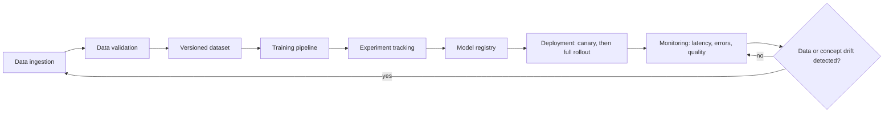
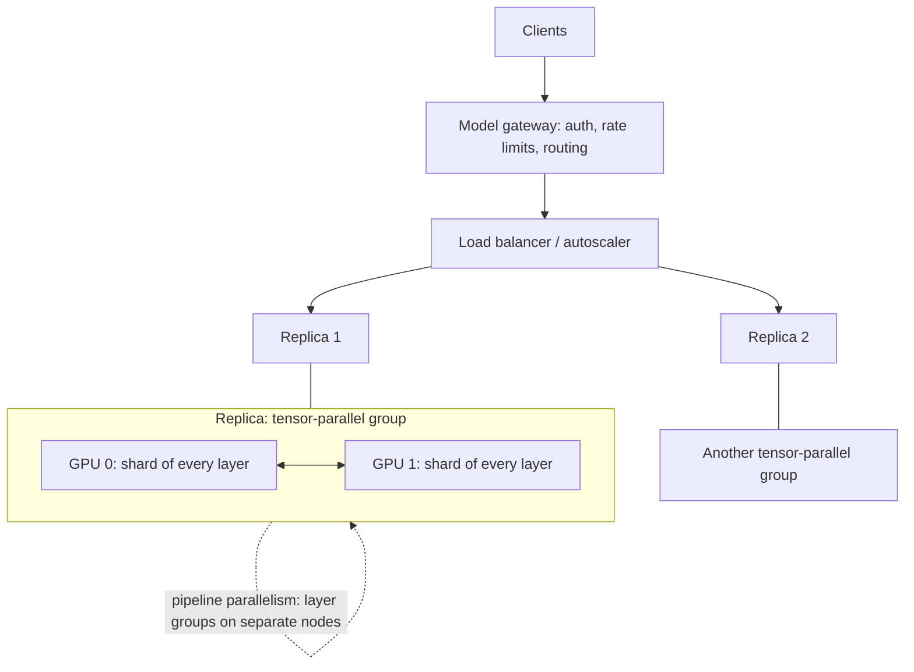

# ML lifecycle and distributed inference

**Status: planned design intent.** Nothing here is implemented. These diagrams record the target
architecture so that earlier sections can be built toward it.

## Training and deployment lifecycle

## Distributed inference

Open design questions to resolve with evidence before building: where batching lives (gateway or
replica), how KV-cache memory pressure feeds back into admission control, and how queue depth maps
to autoscaling signals.
