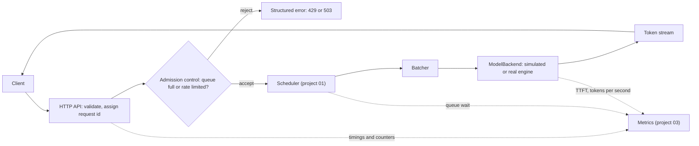
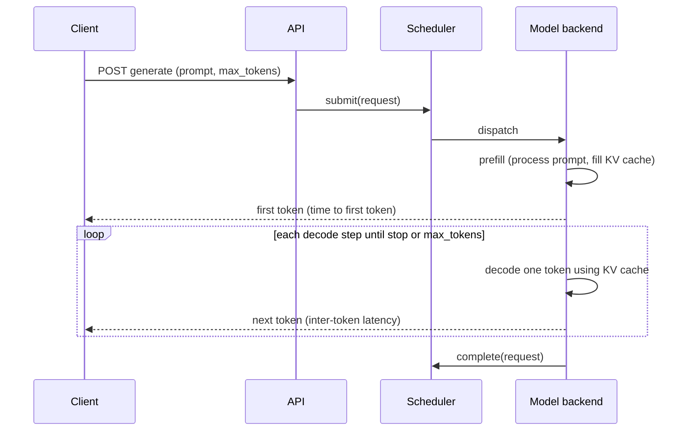

# Model serving and inference request flow

**Status: planned design intent.** Only the `ModelBackend` boundary exists in code
(`projects/02-model-serving-api/src/model_serving/backend.py`) together with the scheduler from
project 01. The API, admission control, batching and streaming layers do not exist yet.

## Serving architecture

## Inference request flow: prefill then decode

An autoregressive model processes the whole prompt once (prefill), then generates one token per
step (decode), reusing cached attention keys and values (KV cache) from earlier steps.

References: Orca (iteration-level scheduling) and vLLM / PagedAttention (KV-cache memory
management); see [07-ai-infrastructure](../../../07-ai-infrastructure/README.md).
