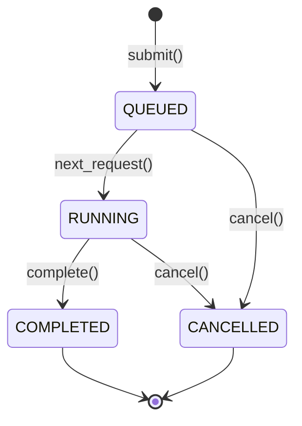
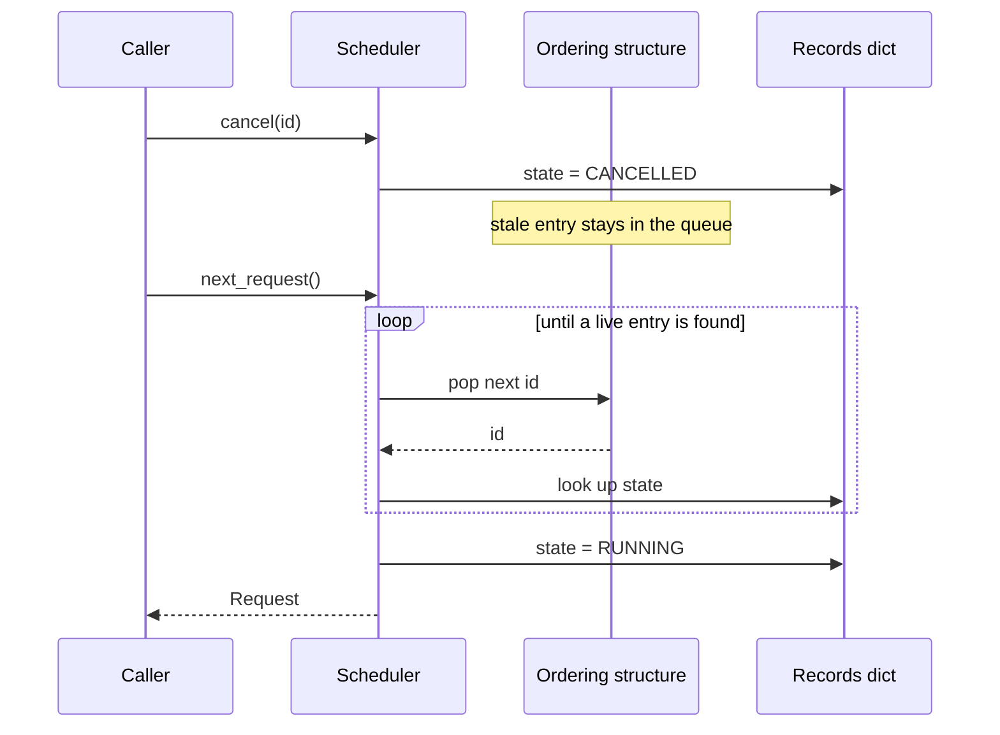

# Request lifecycle

**Status: implemented** in [`projects/01-request-scheduling-engine`](../../../projects/01-request-scheduling-engine/).
Code: `ALLOWED_TRANSITIONS` in `models.py`. Tests: `test_scheduler_lifecycle.py`.

## States and transitions

Any transition not drawn raises `InvalidStateTransitionError`; terminal states are final.

## Dispatch with lazy deletion

`cancel()` marks the request in the records dict (O(1)) and leaves its queue entry in place.
`next_request()` discards such stale entries as they surface.

