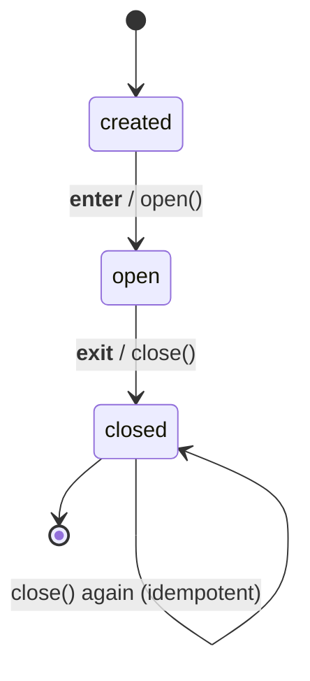
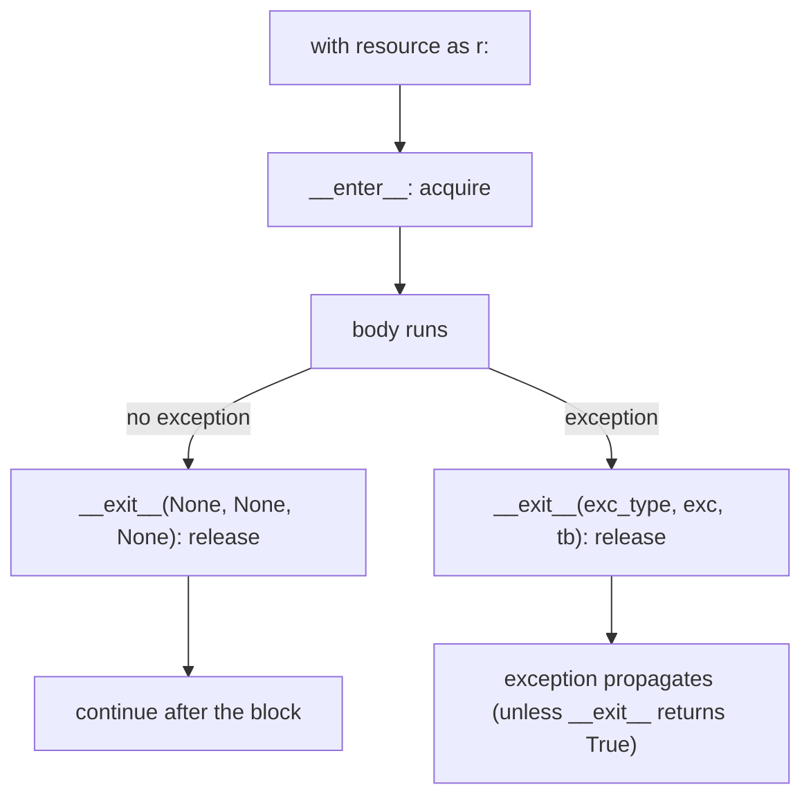

# Resource lifecycle

**Status: implemented** in [`01-python-foundations/context-managers`](../../../01-python-foundations/context-managers/).

`__exit__` runs on normal exit and when the body raises; the exception then propagates.

