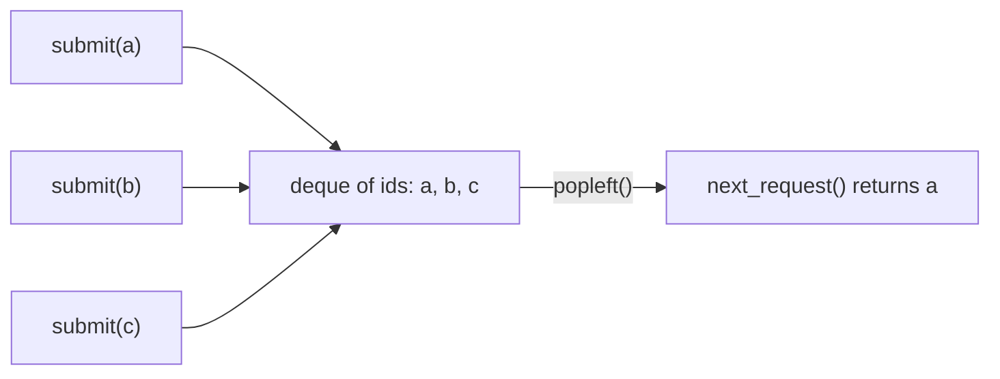
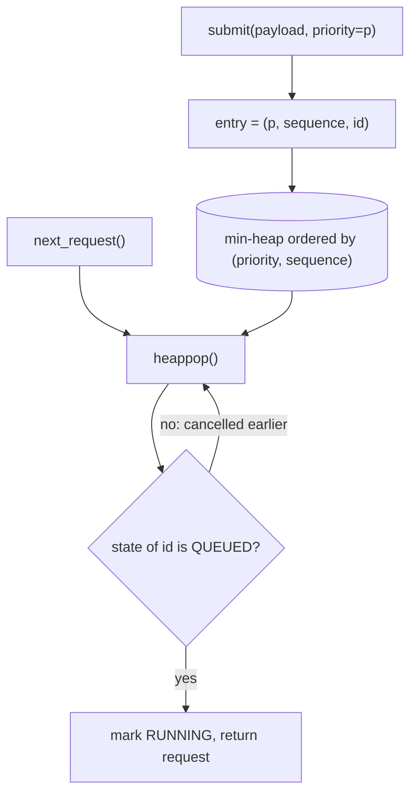

# FIFO and priority scheduling

**Status: implemented** in project 01 (`FifoScheduler`, `PriorityScheduler`).

## FIFO

## Priority with stable ties

Heap entries are `(priority, sequence, request_id)`. `sequence` increases with every submission,
so equal priorities compare by arrival order and the heap never has to compare IDs.

Example with lower number = more urgent:

| Submitted (in order) | Priority | Heap key | Dispatch order |
|----------------------|----------|----------|----------------|
| batch job            | 5        | (5, 0)   | 3rd |
| interactive A        | 0        | (0, 1)   | 1st |
| interactive B        | 0        | (0, 2)   | 2nd |
| background           | 9        | (9, 3)   | 4th |
