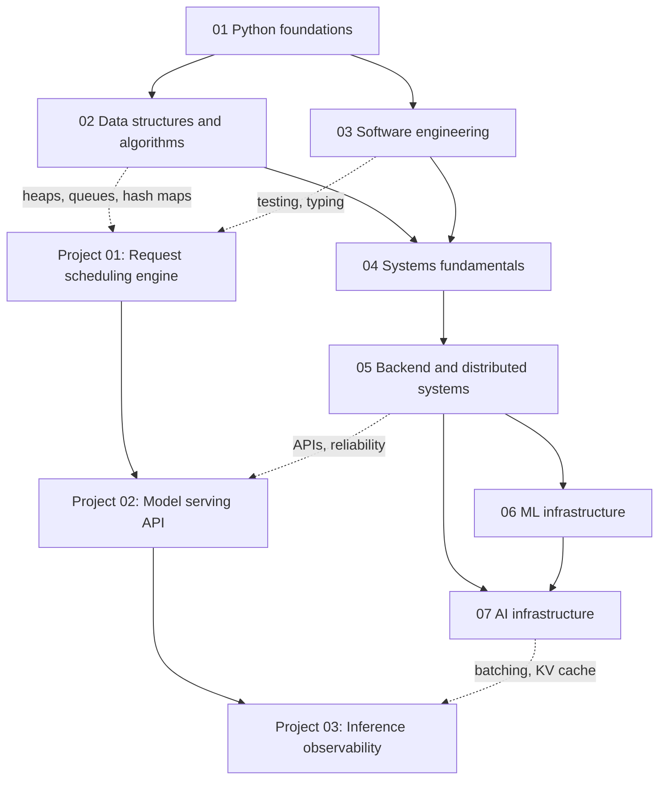
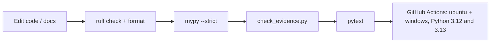

# Repository architecture

## Curriculum dependency graph

Each section assumes the ones before it. Advanced AI-infrastructure topics are only introduced
after the software and systems foundations they rely on.

## Why the layers are ordered this way

| Advanced topic | Needs first | Where it is built |
|----------------|-------------|-------------------|
| Request scheduling | Queues, heaps, hash maps, state machines | 02 then project 01 |
| Dynamic / continuous batching | Scheduling, generators, concurrency | 04, 07 |
| KV cache management | Memory management, allocators, paging | 04, 07 |
| Tail-latency analysis | Percentiles, queueing, profiling | 02, 04, project 03 |
| Model serving API | HTTP, async, validation, timeouts | 05, project 02 |
| Autoscaling and admission control | Backpressure, rate limiting, observability | 05, 07 |

## Source layout and imports

* Study modules in `01`–`03` and `05` are flat: one implementation file and one `test_*.py` file
  per topic directory. Directory names contain hyphens and are not importable packages, so module
  file names are **unique across the whole repository** (pytest runs without `__init__.py` files
  and puts each test's directory on `sys.path`).
* The three projects are proper packages under `projects/*/src/` and are made importable by
  `pythonpath` in `pyproject.toml`.
* One exception: `01-python-foundations/modules-packages/inventory_pkg/` is a real package because
  packages are its subject.

## Tooling flow

`make check` runs the same steps locally.
