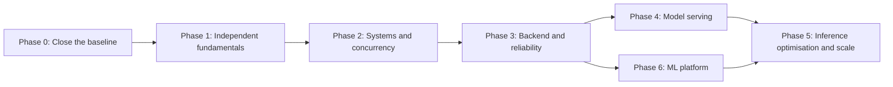

# Learning roadmap

The route from the current baseline to AI-infrastructure work. Phases are gated by **evidence**, not
by calendar time: a phase is finished when its exit evidence exists and has been reviewed, and the
[progress tracker](progress-tracker.md) says so. Effort assumes roughly three focused hours a day;
the durations are planning estimates, not commitments.

| Phase | Focus | Build | Exit evidence |
|-------|-------|-------|---------------|
| **0. Close the baseline** (≈ 2–3 weeks) | Finish unresolved exercises E-01…E-08 | Own versions of queue, heap scheduler, generator, context manager, SQL queries | Each exercise submitted with own tests and reviewed; statuses updated |
| **1. Independent fundamentals** (≈ 4–6 weeks) | Python depth, DSA, testing, typing, Git | Extend project 01: batching with max batch size, token budget, expiry, queue limit | Project 01 progressive features implemented by the owner with their own tests and benchmark |
| **2. Systems and concurrency** (≈ 6–8 weeks) | Processes vs threads, memory, TCP/HTTP, `asyncio`, races, locks, profiling | Thread-safe scheduler; async client/server demo; profiled bottleneck write-up | A reproduced race condition and its fix, with a test; a profile-driven optimisation with before/after measurements |
| **3. Backend and reliability** (≈ 6–8 weeks) | REST, PostgreSQL, transactions, caching, queues, retries, idempotency, Docker, CI/CD | Project 02 API stage: FastAPI + Pydantic, health checks, timeouts, structured errors | Service runs in a container; failure-injection tests for timeouts and retries |
| **4. Model serving** (≈ 6–8 weeks) | Inference architecture, tokenisation, streaming, scheduling, admission control | Project 02 with scheduler, streaming, concurrency limits; a real small local model where hardware allows | Streaming endpoint with measured TTFT and tokens/s, labelled by hardware |
| **5. Inference optimisation and scale** (open-ended) | Dynamic and continuous batching, KV cache, quantisation, GPU profiling, parallelism | Project 03 benchmarks; a simplified continuous-batching simulator validated against the papers' described behaviour | Benchmark report with methodology; clear separation of simulated and hardware results |
| **6. ML platform** (parallel to 4–5) | Data validation, dataset versioning, experiment tracking, registry, drift | A small reproducible training pipeline with tracking and a registry stub | Same inputs reproduce the same artefact; drift check on a recorded dataset |

Rules of progression:

1. Do not start a phase's build before the previous phase's exit evidence is reviewed.
2. Every concept that appears in a build gets a tested implementation or a cited reference
   (the [evidence rule](decisions/0001-evidence-rule.md)).
3. Revisit the roadmap when a measurement or review contradicts an assumption in it.
