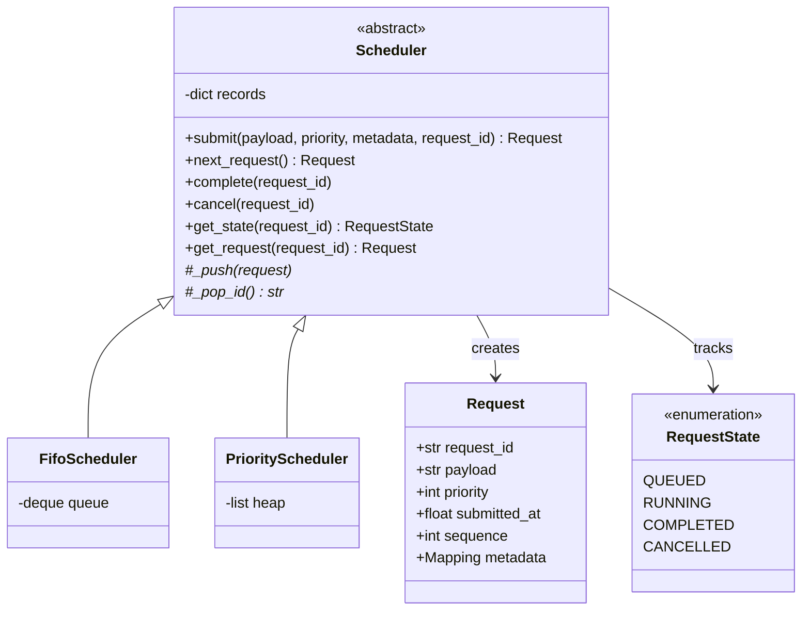

# Request scheduling engine: architecture

## Components

## Design decisions

| Decision | Alternatives considered | Reason and cost |
|----------|-------------------------|-----------------|
| Template-method base class with `_push`/`_pop_id` hooks | Two independent classes; a policy object | One implementation of lifecycle and validation, tested once for both policies. Cost: inheritance coupling; a policy object would be preferable if policies needed runtime swapping |
| Lazy deletion for cancellation | Remove from the middle (O(n)); indexed heap with decrease-key | O(1) cancel and simple code. Cost: stale entries hold memory until they surface |
| Heap key `(priority, sequence, id)` | Store the `Request` in the heap | Unique, cheap tuple comparison; never compares payloads; sequence gives stability |
| Lower number = more urgent | Higher number = more urgent | Matches `heapq` min-heap directly; documented on `Request` and in the README |
| Frozen `Request`; state kept in the scheduler | Mutable `Request` with a `state` field | Immutable data is safe to share with callers; one place owns transitions |
| Deep-copied read-only metadata | Store the caller's dict | Prevents aliasing bugs (see 01-python-foundations/mutability) |
| `request_id` never reused | Allow reuse after completion | Prevents confusion between a new request and stale queue entries or logs; cost: records grow |
| Injected `clock` and `id_factory` | Call `time`/`uuid` directly | Deterministic tests with no sleeping |
| Standard library only | A queue or scheduling library | The goal is to understand the mechanism |

## Invariants (each checked by tests)
1. `len(scheduler)` equals the number of requests in state QUEUED.
2. Every request in the records dict is in exactly one state, and only the transitions in
   `ALLOWED_TRANSITIONS` ever occur.
3. A request dispatched by `next_request` is the minimum live entry under the policy's key.
4. A failed operation leaves all state unchanged.
